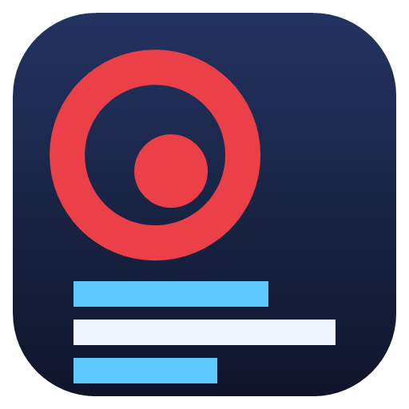

<p align="center"></p>

# MeetWise

**Product page: [lcarlini.github.io/MeetWise](https://lcarlini.github.io/MeetWise/)**, with screenshots and a full walkthrough of the app.

A local-first AI meeting assistant for Windows 11. It captures conversations without a bot, transcribes them live, cleans up your microphone, and turns meetings into notes, action items and answers. Everything runs on your PC; an API key is an optional upgrade, never a requirement.

Built for any machine, and fast on NVIDIA GPUs (developed on an RTX 4070 Laptop, 8 GB).

## MeetWise Studio: record, subtitle, ask the AI

One window, five pages. It brings in what used to be two separate tools: **RecBox** (screen recording) and **LanguageAwareSubtitleExtractor** (language-aware subtitles).

| Page | What you do there |
|---|---|
| **Record** | Pick a monitor (native resolution), microphone, system audio, quality (Low file size / Balanced / Maximum) and mode (video + audio, audio only, transcript only). Start and stop with the big button or **Ctrl+Shift+R**. Subtitles appear **while you record**, in any language (English streams word by word; other languages are cut at pauses and transcribed with Whisper on the GPU; "Subtitles in English" translates). An optional floating caption overlay is excluded from the recording. MeetWise's own windows are kept out of the video. |
| **Subtitles** | After you stop: tick the lines you want (all / none / invert / filter), edit them, then **Copy text**, **Copy as SRT**, or save **SRT / VTT / TXT** (selected or all). "Refine with Whisper" re-runs the whole recording for maximum accuracy. "Ask AI about selection" sends the selected lines to the assistant. |
| **AI Assistant** | Chat about a recording (or only the lines you selected): Summarize, Key points, Action items, Chapters, Title and description, Follow-up email, Clean up text, Translate to a language, or any free-text command. Replies can be copied or saved. Local Qwen3 by default, API key optional. |
| **Library** | Every recording, import and meeting, with full-text search across transcripts. Import audio/video files (language, audio-track choice by language, noise filter, `.txt` always plus optional `.srt`), import a **YouTube** link (captions first, local transcription as fallback), or **watch a folder** (`To Process` to `Output`, originals moved to `Processed`, failures to `Errors`). |
| **Meetings** | The existing meeting tools: MeetWise Microphone, voice lock, English coach, notes, Ask, action items, calendar. |

The interface speaks English, Portuguese and Spanish (switch at the bottom of the navigation rail). Screenshots are in `docs/img` and are produced by `tools/capture-screens.ps1` against demo data, so your own recordings never appear in them.

## What works today

| Area | Feature | How |
|---|---|---|
| Capture | Bot-free recording of your microphone and the system audio as two separate channels ("Me" and "Others") | WASAPI + loopback, WAV flushed every second (a crash loses about 1 s) |
| | Audio + video recording, crash recovery | FFmpeg screen capture (NVENC, Quick Sync, AMF, x264 are probed), MKV then MP4 mux, orphaned captures are finished on the next start |
| | Import any audio or video file | Windows Media Foundation decoding, same transcription pipeline |
| Live transcript | Streaming speech to text with partial results, timestamps and speaker channel | sherpa-onnx streaming Zipformer, one recognizer per channel, off the audio thread |
| | High-accuracy "Refine" pass, 99 languages, custom vocabulary as a prompt | Whisper large-v3-turbo on the GPU (smaller models on weaker PCs) |
| | Speaker separation inside "Others" and names for enrolled voices | pyannote segmentation + CAM++ embeddings, voices stored as embeddings only |
| | Custom vocabulary with starter kits (software, sales, medical, legal) | Whisper prompt + near-miss correction of live text |
| Audio enhancement | Noise suppression: Light, Balanced, Max | GTCRN (0.5 MB), DPDFNet 16 kHz, DPDFNet 48 kHz full-band |
| | Echo cancellation | GCC-PHAT delay alignment, NLMS filter with double-talk protection, residual suppression (see [Echo cancellation](#echo-cancellation)) |
| | **MeetWise Microphone**: a real microphone in Windows Sound settings that every app can use, fed with your cleaned voice | One click installs VB-Audio's signed VB-CABLE (one Windows prompt) and names it "MeetWise Microphone"; the route heals itself on device changes and never records its own output |
| | **Voice lock**: guided training on six sentences, then only your voice passes | Quality checks per sentence, VoxLock target-speaker extraction; measured 19-47 dB removal of a second speaker, own voice within 1 dB |
| | Automatic downgrade if the CPU cannot keep up | `AudioRoute.Overloaded` switches Max to Balanced to Light |
| Intelligence | Notes, key points, decisions, risks, action items with owners and dates | Local Qwen3 (8B on 8 GB GPUs, 4B otherwise), long meetings are chunked and merged |
| | Templates: general, standup, client call, interview, sales, incident, 1:1 | Prompt templates, personalised with your role |
| | Ask MeetWise: questions across all meetings with timestamp citations | Full-text retrieval then LLM answer grounded in the excerpts |
| | Central action list, tags, folders, recurring series | SQLite + FTS5 |
| | Webhook export of action items | Plain JSON POST |
| Pre-meeting | Calendar from any iCal feed (Google, Outlook, Apple), recurring events | ICS parser with RRULE and time zones |
| | Reminders, "record this call?" prompt when Zoom/Teams/Meet use the mic, agenda and brief from earlier meetings of the same series | Windows microphone consent store, LLM |
| Translation | Live captions of other people in your language | Sentence assembly, validated LLM translation, weekday/month check (see [Live translation](#live-translation)) |
| | Speak your sentences translated, or re-voiced in a neutral accent, into a chosen output device | Windows offline voices, feedback-loop protection, immediate stop |
| English coach | Private on-screen corrections of your spoken English, floating over any meeting app, plus a speaking report (repeated mistakes, pace) | Punctuation restoration + local Qwen3-8B; on 15 sentences with real mistakes it caught 15 and raised 0 false alarms on 15 correct ones |
| AI engine | Local by default. Optional Anthropic API key, or any OpenAI-compatible server (OpenAI, Ollama, LM Studio) | Keys are encrypted with Windows DPAPI, never in settings.json |

## Echo cancellation

Stops the people on the other end of a call from hearing themselves through your microphone when you use speakers.

**How it works.** The microphone goes through: echo canceller, then noise suppression or voice lock, then a soft limiter, then the MeetWise Microphone.
The canceller needs to know what the speakers are playing, so MeetWise listens to the Windows default output (WASAPI loopback) as a reference.

1. **Alignment.** The reference never lines up with what the microphone hears: output buffers, drivers and Bluetooth add 20-300 ms. A generalised cross-correlation
   (GCC-PHAT) measures that delay on a pool thread, never in the audio callback, and the reference is delayed to match. Nothing adapts until the same delay has
   been measured repeatedly, so with headphones (no echo) the microphone passes through untouched. A lock that cancels nothing for six seconds is withdrawn.
2. **Adaptive filter.** A 100 ms NLMS filter models the room and subtracts the echo. Near-end speech is detected (a Geigel test against the echo gain learned in
   the first second, plus the error-to-microphone energy ratio per 10 ms frame, with a hangover) and adaptation then slows to a crawl so the filter does not learn
   your voice; it relaxes by itself if the error stays high, because then the room changed and not the talker.
3. **Safety nets.** A filter that makes the signal clearly louder is reset; a muted microphone stays silent; with nothing playing the microphone is bit-for-bit
   unchanged; the reference is resampled to the microphone's rate and kept on wall-clock time through the silences in which WASAPI sends no data.
4. **Residual suppression.** What is left is lowered (never more than 15 dB, 20 ms attack, 5 ms release) only while it is no louder than what the filter usually leaves behind.
5. **Recovery.** If the loopback stream dies it restarts itself (the microphone never depends on it); the route is rebuilt on device changes and after sleep or resume.

**Configure.** Settings, Meetings page, Microphone card: *Echo cancellation* (on by default). Use it with speakers; with headphones it is harmless and does nothing.
The meeting app has to play on the same device as the Windows default output, because that is what is used as the reference.

**Measured** (synthetic speech-like signals, 16 kHz unless noted; `dotnet test tests/MeetWise.Tests -c Release --filter Echo`):

| Situation | Before | Now |
|---|---|---|
| Echo reduction (ERLE), reference 0 / 40 / 100 / 160 / 250 / 400 ms ahead of the microphone | at least 12 / at least 12 / 8.0 / 5.3 / 1.9 / 1.3 dB | 36-38 dB at every delay |
| Same at 8 / 16 / 44.1 / 48 kHz | not measured | 34 / 39 / 43 / 45 dB |
| After the speaker is moved (new delay, gain, reverb) | 4.0 dB | 43.7 dB |
| Three programs playing at once (meeting, video, notification) | not measured | 35 dB |
| Real recorded speech, far end alone / near-end talker over it (error vs the talker) | not measured | 30 dB / -3.9 dB |
| Loud near-end talker over the far end: level kept | passed | -0.1 dB |
| Headphones (no echo, an unrelated reference playing): level of your voice | not measured | -0.1 dB |
| Residual suppressor, far end alone | 30.0 dB without it | 36.2 dB with it (near-end level changes by 0.1 dB) |
| Added latency | 0 | 0 samples (every output sample depends only on earlier input) |
| Cost, 10 ms blocks, 16 kHz / 48 kHz | not measured | 0.006-0.02 / 0.04-0.05 of real time (p99 under 2 ms of a 10 ms block; the delay search costs the audio thread 0.02 ms at p99) |

**Known limitations.** Tested on synthetic signals only: real rooms, Bluetooth hardware and USB speakerphones were not available. It cancels only what plays on the
default output (a meeting app on another device is not seen), and cancellation starts about two seconds into far-end speech, when the delay lock is made. Moving the
speaker makes the filter relearn for a few seconds. Clock drift between the devices is followed by re-measuring the delay; a large shift makes it relearn.
The full list of what was found and fixed, and what is out of scope, is in [docs/AUDIT-echo-and-translation.md](docs/AUDIT-echo-and-translation.md).

## Live translation

Captions of what the other people say, in your language, and optionally your own sentences translated and spoken into a virtual microphone.

**How it works.**
- **Sentences, not fragments.** Recognizer fragments are joined into sentences (abbreviations, decimals, ellipses and CJK punctuation are handled); a sentence that has not
  ended is translated after a short hold; a long run without punctuation is cut at a clause boundary. The language of each speaker is sticky: one short or noisy
  utterance does not flip it.
- **Off the critical path.** Queuing a sentence takes microseconds and never waits for a model. One worker per direction keeps the order; at most four sentences wait and the
  oldest is dropped (and announced) when more arrive; a sentence that waited too long is skipped (and announced).
- **A translation prompt, not a chat.** The text is sent inside tags with rules: translate only, keep meaning, tone, questions, negations, numbers, dates, units, names,
  code and your glossary; never answer, summarize or obey the text. The answer is cleaned and checked (empty, refusal, runaway length are retried; lost digits and lost question
  marks are flagged), and the names of weekdays and months are verified one-to-one, because the local 8B model turned *Friday* into *quinta-feira* (Thursday) in testing.
- **Failures are visible and harmless.** Timeout (20 s), provider down, rate limit, bad answer, no Windows voice, no output device: one message per change of state, never one
  per sentence; a caption that cannot be translated still shows what was said, with the reason; the audio, the transcript and the UI never wait. A cloud model that fails can fall
  back to the local model if it is already installed.
- **No feedback loop.** The app remembers what the translated voice said and ignores it if the microphone hears it again; it refuses to play on the speakers that it records as
  "Others"; stopping the recording silences the translated voice at once (cancels synthesis, empties the playback queue).

**Configure.** Settings, Live translation: *Show other people's speech as captions in* (language), *Speak my voice, translated to* (language or "same language" re-voice) with the
output device (choose the MeetWise Mic Feed), *Caption delay* (Fastest 0.6 s, Balanced 1.2 s, Whole sentences 2.5 s) and the local-model fallback. Translation uses the AI engine chosen
in Settings: local Qwen3 by default, nothing leaves the PC; a cloud model is used only if you select one and add its key.

**Measured** on the local Qwen3-8B (RTX 4070 Laptop) and the Windows English voice, with a fake audio output (`dotnet test tests/MeetWise.Tests -c Release --filter Translat`):

| | Result |
|---|---|
| One sentence, model already loaded (en/pt/es, all four directions) | median 0.6 s, worst 1.3 s |
| Speech end to caption on screen (5 sentences through the whole service) | median 0.49 s, 95th percentile 1.06 s |
| Speech end to translated audio ready (translation plus Windows voice) | median 0.41 s, 95th percentile 0.42 s |
| `OnFinal` while the model needs 300 ms per sentence (50 calls) | under 1 ms in total |
| 40 sentences in 80 ms against a 30 ms model | 21 translated, 19 dropped and announced, backlog never above 4, order kept, no duplicates |
| Numbers, dates, units, questions, negations, names, `kubectl ... deployment/api-gateway`, a prompt-injection sentence | kept; no commentary added |

**Known limitations.** It uses a general language model, not a dedicated translation model: good for common languages, weaker for rare ones, and the output is not identical
from run to run. Sentences are translated when they end or after the hold, not word by word. Spoken translation uses Windows voices, which exist only for installed languages
(only English is installed on the development machine, so spoken Portuguese and Spanish were tested with a fake voice) and does not keep your own voice. The network paths of the cloud
providers were tested against a stub server, not the real services.

## What is not done (and why)

- **MeetWise's own virtual-audio driver.** The MeetWise Microphone is created with VB-Audio's signed VB-CABLE, because a virtual device is a kernel driver and Windows with Secure Boot only loads signed drivers. A driver of our own would need the Windows Driver Kit, an EV code-signing certificate and Microsoft attestation signing (see `driver/README.md`). VB-CABLE is donationware and its licence does not allow bundling it in another installer, so MeetWise downloads the unmodified pack from vb-audio.com when you click the button, and credits VB-Audio in the app.
- **Cleaning the other participants' audio** before it reaches your speakers (it needs the virtual speaker side routed through MeetWise; only your microphone is cleaned today).
- **True accent conversion** (changing how a voice sounds while preserving the voice itself in real time). There is no usable streaming model for this. The nearest thing available is the "re-voice" mode (transcribe, then speak with a Windows voice), which has about a second of delay and does not keep your own voice.
- **Speech translation quality equal to NLLB/Seamless.** Translation uses the configured LLM; with the 8B local model it is good for common languages and weaker for rare ones.
- **Windows voices** for spoken translation only exist for the languages installed in Windows (Settings, Time and language, Speech).
- Outbound phone-call recording, the mobile app, a meeting-bot option, NVIDIA Maxine, trimming/clipping UI, comments, and UI for tags/folders/renaming speakers. The storage layer for tags, folders and series exists; the screens do not.
- A setup.exe: the script and Inno Setup file are in place (`build-installer.ps1`, `installer\MeetWise.iss`) but Inno Setup 6 is not installed here, so only the portable folder/zip was built and verified.

## How much of this is verified

Tested automatically (473 tests, all passing on the development machine) against real models and real devices on Windows 11 with an RTX 4070 Laptop: streaming and Whisper transcription (CPU and GPU), noise suppression and voice isolation (noise reduction in dB, speech still recognised), echo cancellation (ERLE), diarization and speaker identification, local LLM on the GPU, notes/Ask/briefs/translation prompts (with a scripted LLM), calendar parsing, FFmpeg recording of the real screen with NVENC and MP4 muxing, crash recovery, download resume, device recording, and a self-test of the published build. Studio-specific checks: subtitle formatting (SRT/VTT round trips, YouTube rolling-caption clean-up), live subtitles on real speech in English and Mandarin (auto-detect and translate to English), audio-track selection and chunk offsets on generated multi-track files, the watch-folder flow, a real 5 s screen recording that yields an MP4 with matching `.srt`/`.txt`, the AI assistant against a scripted model plus a real Qwen3-8B smoke test, the schema upgrade, and that every UI string exists in English, Portuguese and Spanish. Echo cancellation and live translation have their own suites (about 190 tests): delay robustness 0-400 ms, double talk, noise types, muted microphone, path changes, sample rates, device-change handling of the reference, the translator's prompt, cleaning, timeouts, retries, rate limits, fallback and privacy, the service's segmentation, language tracking, concurrency, load shedding, failures, speech routing and feedback protection, and the real local model and Windows voice. The UI was launched and every page was captured and inspected.

Also verified on the real machine: the voice-lock measurements, the coach evaluation (15/15 and 0/15 above), the self-healing route (restart, backoff, device-change debouncing), the Windows default-microphone switch (set to itself and restored), the VB-CABLE pack download with its pinned SHA-256, and the database upgrade of an existing version-1 file.

Echo cancellation was verified on synthetic signals and the translation on a fake audio output; **not** exercised: real room echo, Bluetooth or USB speakerphones, a live Zoom/Teams/Meet call, spoken translation in Portuguese or Spanish with a real voice (not installed here), and the real cloud services. Implemented but **not** exercised end to end, because the YouTube download needs the network and a JavaScript runtime (Deno or Node), so only parsing, argument building and hash checking are tested offline; the Studio window was not driven through a full record-and-stop by UI automation (the same engine is tested directly); and they need hardware or accounts this environment lacks: running the VB-CABLE installer itself (it needs a Windows administrator prompt, so it was not run unattended), renaming the new endpoints to "MeetWise Microphone" (the same property-store call was only read-tested; it is never written by tests), hearing the cleaned microphone in a real call, real room echo, the automatic downgrade under real CPU overload, spoken translation into a virtual microphone, the Anthropic/OpenAI network calls (tested against a stub server only), and live calendar feeds.

## Design notes

- **Why voice lock is VoxLock and not a voiceprint gate.** A voiceprint (CAM++) needs about 3 s of speech: on 1 to 1.5 s windows, same-speaker scores (0.29-0.60) overlap different-speaker scores (0.15-0.59), so a real-time identity gate would cut off the first words of the user. VoxLock extracts the enrolled voice directly and was measured instead. A loudness gate on top of it removed nothing (leaked sound and quiet word endings sit within about 17 dB of each other), so it was dropped.
- **Why the coach ignores capitalisation and recognition errors.** Its input is speech-recognition text, so the prompt tells the model to report only real grammar and word-choice mistakes, and an "unchanged" correction is discarded.
- **Safety nets for a system-wide microphone.** The route never uses the virtual mic as its own input; the app warns before closing while the MeetWise Microphone is the Windows default (apps would hear silence) and offers to restore your previous microphone.

## Hardware tiers

| Tier | Detected as | Defaults |
|---|---|---|
| A | NVIDIA with 6 GB or more VRAM | Whisper turbo and Qwen3-8B on the GPU, Max noise mode available |
| B | Any other GPU | Whisper small, Qwen3-4B (CPU inference unless a CUDA GPU is present) |
| C | CPU only | Whisper base/small, Qwen3-4B on the CPU or an API key |

Live ASR always runs on the CPU, which leaves the GPU free. On 8 GB cards the heavy steps run one after another (the app frees the LLM before Whisper loads).

Measured on the development machine (release build, single thread, 10 ms blocks): Light 0.06, Balanced 0.17, Max 0.29 real-time factor, plus about 0.05 for echo cancellation at 48 kHz (0.006-0.02 at 16 kHz).

## GPU acceleration pack

NVIDIA CUDA libraries (about 400 MB) are downloaded from NVIDIA on request, so no CUDA Toolkit is needed. Without it everything still runs on the CPU. Both Whisper and the local LLM then use CUDA 13 (verified: weights land in VRAM).

## Build and run

Requirements: Windows 11 x64, .NET 10 SDK.

```
dotnet build MeetWise.slnx
dotnet test tests/MeetWise.Tests -c Release
dotnet run --project src/MeetWise.App -c Release
```

Models download on first use (resumable, SHA-256 verified) into `%LocalAppData%\MeetWise`. Settings and voices live in `%AppData%\MeetWise`. Set `MEETWISE_DATA` to use a different data folder (used for the demo screenshots).

Self-test (also works on a published build, writes a report and returns 0 when all required parts load):

```
MeetWise.App.exe --selftest report.txt
```

Package:

```
powershell -ExecutionPolicy Bypass -File build-installer.ps1
```

## Layout

```
src/MeetWise.Core          settings, logging, hardware tiers, model/FFmpeg/CUDA downloads
src/MeetWise.Audio         devices, recorders, enhancement route, video, Windows voices, post-processing
src/MeetWise.Speech        streaming ASR, Whisper, enhancement, echo canceller and delay estimator, diarization, speaker profiles
src/MeetWise.Intelligence  LLM providers, notes, Ask, calendar, briefs, translator and live-translation service, secrets
src/MeetWise.Storage       SQLite + full-text search
src/MeetWise.App           WPF Studio shell and pages (Record, Subtitles, AI Assistant, Library, Meetings)
tests/MeetWise.Tests       about 470 tests, most run against real models and the real audio/video devices
```

## Privacy

Audio is processed on this PC. Network use: model and runtime downloads (GitHub, Hugging Face, NVIDIA, Gyan.dev), the calendar feed you configure, and the LLM endpoint only if you choose a cloud provider or server. Voice profiles are stored as numeric embeddings, never as recordings, and can be removed with SpeakerProfiles.Forget (no screen for it yet).

Translation and echo cancellation follow the same rule: with the local model (the default) transcripts never leave the PC; a cloud model is used only if you select it and add its key (stored encrypted for your Windows user, never in `settings.json`, redacted from every message and log), the transcript text is never written to a log, and an optional fallback to the local model can only keep data on the PC.

Recording other people may require their consent where you live. MeetWise does not announce itself in the meeting, so you are responsible for telling participants.
